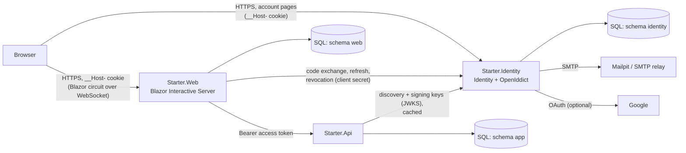

# Architecture

## Components

| Component | Responsibility | Talks to |
| --- | --- | --- |
| **Starter.Identity** | Accounts (ASP.NET Core Identity), account pages, Google sign-in, issuing tokens (OpenIddict) | SQL `identity` schema, SMTP, Google |
| **Starter.Api** | Business endpoints. Validates access tokens; takes the user id from the token | SQL `app` schema, identity server (keys only) |
| **Starter.Web** | Blazor UI. Confidential OpenID Connect client; keeps tokens in a server-side session | SQL `web` schema, identity server, API |
| **Starter.Contracts** | Request/response records and validation attributes shared by the API and its clients | — |
| **Starter.Ui** | One stylesheet for the app and the account pages | — |

### Why the identity server is a separate application

- It is the only place that handles passwords, Google and token signing keys. A bug in the UI or in a
  business endpoint cannot leak them.
- Every client is equal: the Blazor app today, a mobile app later (a public client using the same
  Authorization Code + PKCE flow), other APIs. None of them needs to change when another is added.
- The API has no cookies and no HTML pages. It only accepts `Authorization: Bearer` access tokens.

The cost is a third process to run and deploy. For a very small application you could host the identity
server inside the API process; the code is organised so that this remains a mechanical change.

## Database

One SQL Server / Azure SQL database, one schema per application, one EF Core `DbContext` per application:

| Schema | Owner | Tables |
| --- | --- | --- |
| `identity` | Starter.Identity | `AspNetUsers` and other Identity tables, `OpenIddict*`, `DataProtectionKeys`, `__EFMigrationsHistory` |
| `app` | Starter.Api | `Notes`, `__EFMigrationsHistory` |
| `web` | Starter.Web | `Sessions`, `DataProtectionKeys`, `__EFMigrationsHistory` |

Each application connects with its own database user that may only read and write its own schema
(`GRANT SELECT, INSERT, UPDATE, DELETE ON SCHEMA::...`). Schema changes are made by a separate migration
identity (`db_ddladmin`). So the web app cannot read password hashes, the API cannot read sessions, and no
application can alter tables at run time. One database keeps costs and operations simple; splitting a schema
into its own database later only changes a connection string.

Scripts: [`deploy/sql/create-database-and-users.sql`](../deploy/sql/create-database-and-users.sql) (local, SQL logins)
and [`deploy/sql/azure-sql-users.sql`](../deploy/sql/azure-sql-users.sql) (Azure SQL, managed identities).

### Migrations

- Each application has its migrations in `Data/Migrations`.
- Applying them is an explicit step: run the app with `--migrate` (uses `ConnectionStrings:Migrations`).
  Docker Compose does this in the `*-migrate` services; in Azure it is a deployment step
  ([azure-deployment.md](azure-deployment.md#4-database-migrations)).
- Only in the `Development` environment, and only when `Database:MigrateOnStartup` is `true`, an app migrates
  itself at startup. Production never does.
- The identity server's migration step also creates or updates the OpenIddict client registrations from
  configuration (`OpenIddict:Clients`).

## Sign-in flow

1. The browser opens a protected page of Starter.Web. The endpoint requires an authenticated user; the
   OpenID Connect handler redirects to `https://<identity>/connect/authorize` with `response_type=code`,
   a PKCE `code_challenge` (S256), `state`, `nonce` and the scopes
   `openid profile email offline_access starter_api`.
2. OpenIddict validates the client id, the redirect URI (exact match with the registration), PKCE and scopes.
   The user is not signed in to the identity server, so it shows `/Account/Login`.
3. The user signs in with a password (lockout after 5 failures) or with Google. The identity server sets its
   own `__Host-starter-identity` cookie and returns to the authorization endpoint, which issues a one-time code
   and redirects the browser to `https://<web>/signin-oidc?code=...` (query response mode — no auto-posting
   form, so the strict CSP needs no inline script).
4. Starter.Web exchanges the code at the token endpoint, server to server, with its client secret and the PKCE
   verifier. It receives an access token (JWT, 5 minutes), a refresh token and an id token.
5. The cookie handler stores the authentication ticket through `ServerSideTicketStore`: ticket and tokens are
   encrypted with Data Protection and saved in `web.Sessions`. The browser receives `__Host-starter-web`
   containing only the random session key.

Registration is the same flow with `prompt=create` (OpenID Connect Prompt Create): the identity server shows
the registration page; the original authorization request is kept in the return URL, so after email
confirmation and sign-in the user lands in the app.

## Tokens in Blazor Interactive Server

Blazor Server runs components inside a *circuit* — a long-lived server object connected to the browser by a
WebSocket. `HttpContext` belongs to the HTTP request that started the circuit; it is not available (or not
valid) later, so it must not be used to find tokens.

How the starter does it:

- The session key is a claim in the user principal (`starter_session`). Blazor captures the principal when the
  circuit starts and exposes it through `AuthenticationStateProvider`, both during HTTP requests and inside the
  circuit.
- `ApiClient` (scoped = one per circuit, so one per user and tab) asks `SessionTokenService` for an access token
  for that session key, then sets `Authorization: Bearer` on the single `HttpRequestMessage`. The shared
  `HttpClient` from `IHttpClientFactory` never has a default Authorization header.
- `SessionTokenService` (singleton without per-user fields) reads the session from SQL on every call. If the
  token expires within 60 seconds it refreshes it with the refresh token, under a per-session lock, and writes
  the new tokens back. OpenIddict rotates refresh tokens, so each refresh returns a new one.
- Tokens are stored apart from the ticket so that a cookie renewal (sliding expiration) cannot overwrite a newer
  token pair written by the circuit.
- `SessionRevalidatingAuthenticationStateProvider` re-checks every open circuit once a minute. If the session was
  deleted (sign-out in another tab, failed refresh, expiry) the UI switches to signed-out and redirects to sign-in.

## Session lifetimes

| Item | Lifetime | Where configured |
| --- | --- | --- |
| Access token | 5 minutes | `OpenIddict:AccessTokenLifetime` |
| Refresh token | 8 hours, renewed on every use (rotation) | `OpenIddict:RefreshTokenLifetime` |
| Web session (cookie + `web.Sessions`) | 8 hours, sliding on HTTP requests | `AuthenticationSetup.cs` (Web) |
| Identity server cookie | 8 hours, sliding | `IdentitySetup.cs` |
| Security stamp check (identity cookie) | every minute | `IdentitySetup.cs` |
| Circuit revalidation | every minute | `SessionRevalidatingAuthenticationStateProvider` |
| Email confirmation / reset links | 4 hours | `IdentitySetup.cs` |

Activity inside an open circuit does not slide the web session cookie (there are no HTTP requests); it does keep
refreshing the tokens. After 8 hours without a page load the user signs in again (silently if the identity
server session is still valid).

## Sign-out and session revocation

| Event | What happens | When other sessions notice |
| --- | --- | --- |
| Sign out in the web app | Web session row deleted, refresh token revoked, browser sent to the identity server's end-session endpoint with `id_token_hint`, identity cookie deleted | Other tabs of the same browser: next HTTP request, or at the latest the next circuit revalidation (≤ 1 min) |
| Password change (account page) | Security stamp updated; all OpenIddict authorizations and tokens of the user revoked; the current browser keeps its identity session | Other browsers: identity cookie rejected within 1 min; web sessions end at their next token refresh (≤ 5 min) + revalidation (≤ 1 min) |
| Password reset (email link) | Same as above, for all sessions | Same as above |
| Account deleted / not allowed to sign in | Refresh is refused by the token endpoint | ≤ 5 min + 1 min |

Already issued access tokens are self-contained JWTs that the API validates without calling the identity server,
so **an access token stays valid until it expires — at most 5 minutes after sign-out or a password change**.
They live only in the web server's memory and database (deleted at sign-out), never in the browser, so in
practice nobody can use them after sign-out. If immediate revocation is required, switch the API to OpenIddict
introspection or token-entry validation (a database or HTTP lookup per request) — see [security.md](security.md).

## Request handling and errors

- The API returns RFC 9457 problem details: 400 with field errors for validation, 401 without/with an invalid
  token, 403 for a valid token without the API scope, 404 for records that do not exist **or belong to someone
  else** (the API does not reveal which), 413 for bodies over 64 KB, 429 with `Retry-After` when rate limited.
  Exception details are never returned.
- `ApiClient` turns these into `ApiResult<T>` with a user-friendly message; components never see HTTP details.
  An unreachable API or identity server shows "temporarily unavailable" with a retry button.
